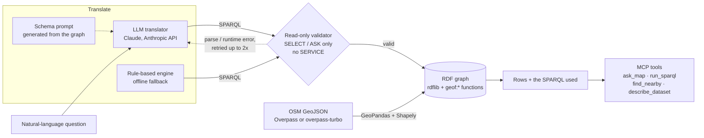

<p align="center">
  
</p>

<p align="center">
  <a href="https://github.com/YOUR_GITHUB_USERNAME/nl-map-query/actions/workflows/ci.yml"></a>
  
  
  
  
  
</p>

<p align="center">
  <b>
    <a href="#quick-start">Quick start</a> ·
    <a href="#see-it-work">Demo</a> ·
    <a href="#how-it-works">How it works</a> ·
    <a href="#use-it-from-claude-mcp">MCP</a> ·
    <a href="#the-graph-model">Graph model</a> ·
    <a href="#real-openstreetmap-data">Real data</a> ·
    <a href="#roadmap">Roadmap</a>
  </b>
</p>

---

**mapkg** turns a map into something an AI can *reason over and be checked on*. It loads OpenStreetMap
features into an **RDF knowledge graph**, lets an **LLM translate plain-English questions into SPARQL**, runs that query
against the graph, and serves the whole thing as an **[MCP](https://modelcontextprotocol.io) server** so Claude (or any MCP client) can
call it as a tool.

> **Why a query language instead of letting the model answer directly?**
> A model that answers "what's near the campus?" from memory can hallucinate. A model that writes a
> *query* produces something auditable: every answer ships with the exact SPARQL that produced it, the
> database does the geometry, and a read-only validator sits between the two.

<table>
<tr>
<td width="33%" valign="top">

### 🗺️ Map → knowledge graph
GeoPandas + Shapely turn OSM GeoJSON into RDF with **GeoSPARQL-style geometries**, tag triples, and precomputed lengths and areas.

</td>
<td width="33%" valign="top">

### 💬 Question → SPARQL
An LLM gets a schema prompt **generated from your data**, writes the query, and **retries with the parser's error** if it's wrong. An offline rule-based engine covers common shapes.

</td>
<td width="33%" valign="top">

### 🔌 Graph → MCP tools
`ask_map`, `run_sparql`, `find_nearby`, `describe_dataset`. Works with **both MCP SDK v1 and v2**, over stdio.

</td>
</tr>
</table>

## See it work

<p align="center">
  
</p>

<sub>This image is generated from the tool's real output by <a href="scripts/make_demo_svg.py"><code>scripts/make_demo_svg.py</code></a>, so it can't drift from what the CLI prints. It used the offline engine, so anyone can reproduce it without an API key.</sub>

More questions the bundled sample dataset answers out of the box (offline engine):

| Question | Answer |
|---|---|
| *Which cafes are within 1 km of NMIMS?* | Sample Cafe VP1 (86 m) · VP2 (305 m) · VP3 (756 m) |
| *Nearest pharmacy to NMIMS Mumbai Campus* | Sample Pharmacy 1, 164 m |
| *Hospitals within 3 km of Bandra* | Lilavati Hospital, 1,278 m |
| *Distance between Dadar and Bandra* | 4,067 m |
| *Largest park* | Oval Maidan, 150,285.8 m² |
| *Longest road* | Western Express Highway, 9,891.3 m |
| *How many hospitals are there?* | 4 |

The LLM engine handles what fixed rules can't (multi-condition filters, tag lookups, aggregations, joins). The
rule-based engine is deliberately small: a fallback and a way to run everything offline, not a general parser.

## Quick start

```bash
git clone https://github.com/YOUR_GITHUB_USERNAME/nl-map-query.git && cd nl-map-query
python -m venv .venv && source .venv/bin/activate      # Windows: .venv\Scripts\activate
pip install -e ".[dev]"

pytest                                                  # 46 tests, runs offline
mapkg ask "Which cafes are within 1 km of NMIMS?"       # works with no API key
```

Turn on the LLM translator for free-form questions:

```bash
export ANTHROPIC_API_KEY=sk-ant-...
mapkg ask "Which pharmacies are closer to Vile Parle station than to Andheri station?"
```

<details>
<summary><b>CLI reference & environment variables</b></summary>

| Command | What it does |
|---|---|
| `mapkg ask "<question>" [--engine auto\|llm\|rules] [--json]` | Natural language → SPARQL → results |
| `mapkg sparql "<query>"` or `@query.rq` | Run your own read-only SELECT/ASK |
| `mapkg schema` | Print the vocabulary and dataset summary the LLM sees |
| `mapkg build --out graph.ttl` | Convert GeoJSON to a Turtle file (`--data` also accepts `.ttl`) |
| `mapkg fetch --bbox S W N E --out file.geojson` | Download real OSM data from Overpass |
| `mapkg serve` | Start the MCP server (stdio) |

| Variable | Default | Meaning |
|---|---|---|
| `ANTHROPIC_API_KEY` | – | Enables the LLM translator |
| `MAPKG_MODEL` | `claude-sonnet-5-5` | Any Claude model id |
| `MAPKG_ENGINE` | `auto` | `auto` = LLM if a key is set, rules as fallback · `llm` = LLM only · `rules` = offline only |
| `MAPKG_DATA` | bundled Mumbai sample | Path to a `.geojson` / `.ttl` file |

</details>

## How it works



1. **Ingest.** `builder.py` reads GeoJSON with GeoPandas, projects to a local UTM zone to compute line lengths and polygon areas in metres, and emits RDF.
2. **Describe.** `schema.py` builds a prompt from the *loaded* graph: vocabulary, spatial functions, feature kinds with counts, feature names, and few-shot examples. Load a different city and the prompt adapts.
3. **Translate.** The LLM returns one SPARQL query. If it fails to parse or run, the error goes back to the model as a follow-up (max 2 retries).
4. **Validate and execute.** Only `SELECT`/`ASK` run, `SERVICE` is refused, and results are row-capped.
5. **Serve.** MCP tools return rows *and* the SPARQL, so the client can show its work.

### Safety model

The LLM is treated as an untrusted query author. Nothing it writes can reach anything except a read-only, in-memory graph.

| Risk | Control | Tested in |
|---|---|---|
| Model (or injected text) emits `INSERT` / `DELETE` | Parser-level allow-list: `SELECT` and `ASK` only | `test_store_safety.py`, `test_llm.py` |
| Model emits `SERVICE <http://…>` to call out | `SERVICE` rejected | `test_store_safety.py` |
| Huge result sets flood the client | Row cap (default 100, hard max 500) with a `truncated` flag | `test_store_safety.py` |
| Malformed SPARQL | Error returned to the model for repair; gives up after 2 retries | `test_llm.py` |
| LLM/API outage | Falls back to the offline rule engine (when `MAPKG_ENGINE=auto`) | `test_llm.py` |
| Tool errors confusing the MCP client | Tools return `{"error": …}` instead of raising | `test_mcp_server.py` |

## Use it from Claude (MCP)

**Claude Desktop**: add to `claude_desktop_config.json` (use absolute paths):

```json
{
  "mcpServers": {
    "mapkg": {
      "command": "/ABS/PATH/nl-map-query/.venv/bin/mapkg",
      "args": ["serve"],
      "env": {
        "MAPKG_DATA": "/ABS/PATH/nl-map-query/data/sample_mumbai.geojson",
        "ANTHROPIC_API_KEY": "sk-ant-..."
      }
    }
  }
}
```

**Claude Code:**

```bash
claude mcp add mapkg -e MAPKG_DATA=/ABS/PATH/nl-map-query/data/sample_mumbai.geojson \
  -- /ABS/PATH/nl-map-query/.venv/bin/mapkg serve
```

| Tool | Purpose |
|---|---|
| `ask_map(question)` | Plain English → SPARQL → rows (returns the generated query too) |
| `run_sparql(query, max_rows)` | Run a read-only SELECT/ASK you wrote yourself |
| `find_nearby(lat, lon, radius_m, kind, limit)` | Features within a radius of a coordinate, optionally filtered by kind |
| `describe_dataset()` | Vocabulary, spatial functions, kinds and names; read it before writing your own SPARQL |

Resource: `mapkg://schema`. When the MCP client is itself a strong model, it can skip `ask_map`, read `describe_dataset`,
and write the SPARQL directly with `run_sparql`.

```jsonc
// tools/call → find_nearby
{ "lat": 19.1004, "lon": 72.8365, "radius_m": 200, "kind": "cafe" }
// → the cafe within 200 m: Sample Cafe VP1
```

## The graph model

Every map object is a `mk:Feature` that is also a `geo:Feature`. This is the real output for one road in the sample data:

```turtle
<https://example.org/mapkg/feature/sample_23> a geo:Feature, mk:Feature ;
    rdfs:label        "Marine Drive" ;
    mk:category       "highway" ;            # primary OSM key
    mk:kind           "primary" ;            # primary OSM value
    mk:geometryType   "LineString" ;
    mk:lengthMeters   3662.3 ;               # lines only (polygons get mk:areaSqMeters)
    osmt:highway      "primary" ;            # every OSM tag is kept as osmt:<key>
    osmt:lanes        "3" ;
    geo:hasGeometry   <.../sample_23/geom> .

<.../sample_23/geom> a geo:Geometry ;
    geo:asWKT "LINESTRING (72.8205 18.9265, 72.8228 18.933, ...)"^^geo:wktLiteral .
```

rdflib has no GeoSPARQL support, so [`geosparql.py`](src/mapkg/geosparql.py) registers the functions map questions need. Distances use a local azimuthal-equidistant projection (via pyproj), so results are in true metres rather than degrees.

| Function | Returns |
|---|---|
| `geof:distance(?a, ?b)` | distance in **metres** (`xsd:double`) |
| `geof:sfWithin(?a, ?b)` | `true` if A lies inside B |
| `geof:sfContains(?a, ?b)` | `true` if A contains B |
| `geof:sfIntersects(?a, ?b)` | `true` if A and B intersect |

You can query it directly. Prefixes `rdf rdfs xsd geo geof mk osmt osm` are predeclared:

```sparql
# Cafes within 500 m of a hospital, nearest first
SELECT ?cafe ?hospital (ROUND(geof:distance(?cw, ?hw)) AS ?metres) WHERE {
  ?c mk:kind "cafe" ;     rdfs:label ?cafe ;     geo:hasGeometry/geo:asWKT ?cw .
  ?h mk:kind "hospital" ; rdfs:label ?hospital ; geo:hasGeometry/geo:asWKT ?hw .
  FILTER(geof:distance(?cw, ?hw) <= 500)
} ORDER BY ?metres
```

<details>
<summary><b>What the LLM sees (excerpt of <code>mapkg schema</code>)</b></summary>

```text
DATA MODEL - every map object is an mk:Feature:
  ?f rdfs:label ?name .                     # name (not every feature has one)
  ?f mk:category ?cat .                     # primary OSM key, e.g. "amenity", "railway", "leisure"
  ?f mk:kind ?kind .                        # primary OSM value, e.g. "cafe", "hospital", "park"
  ?f mk:lengthMeters ?len .                 # LineStrings only
  ?f mk:areaSqMeters ?area .                # Polygons only
  ?f geo:hasGeometry/geo:asWKT ?wkt .       # geometry as WKT (lon lat order, WGS84)

SPATIAL FUNCTIONS: geof:distance (metres) · geof:sfWithin · geof:sfContains · geof:sfIntersects
DATASET: 40 features (Point: 32, Polygon: 4, LineString: 4)
FEATURE KINDS (count): amenity/cafe: 6 · railway/station: 7 · amenity/hospital: 4 · ...
NAMED FEATURES: Andheri; Bandra; Chhatrapati Shivaji Maharaj Terminus; ...
```

Followed by rules ("near" with no number means 1000 m, exclude the anchor itself, etc.) and few-shot examples.

</details>

## Real OpenStreetMap data

The bundled [`data/sample_mumbai.geojson`](data/sample_mumbai.geojson) is **illustrative**: landmark, road and park positions are approximate, and everything named `Sample …` is synthetic. For real data (needs internet):

```bash
mapkg fetch --bbox 19.05 72.80 19.15 72.90 --out data/mumbai_west.geojson   # south west north east
export MAPKG_DATA=data/mumbai_west.geojson
mapkg ask "hospitals within 2 km of Bandra"
```

Any GeoJSON whose feature properties are OSM tags works (overpass-turbo exports, `osmtogeojson`, …).

> Map data © [OpenStreetMap contributors](https://www.openstreetmap.org/copyright), available under the [ODbL](https://opendatacommons.org/licenses/odbl/). If you publish results built from real OSM data, attribute it.

## Tests

```bash
pytest -q        # 46 tests · offline · ~2 s
```

| Area | Tests | What's covered |
|---|---:|---|
| `test_rules.py` | 10 | near / nearest / top-N / count / distance / superlatives / containment, and the "Park inside *National Park*" parsing trap |
| `test_store_safety.py` | 9 | rejects updates, `CONSTRUCT`, `DESCRIBE`, `SERVICE`, bad syntax; row caps; `ASK` |
| `test_geosparql.py` | 7 | metre-accurate distance, CRS-prefixed WKT, topological predicates |
| `test_llm.py` | 7 | prompt contents, retry-with-error loop, give-up path, update smuggling, outage fallback (fake client) |
| `test_graph.py` | 6 | geometry on every feature, tags, typed WKT, lengths/areas, OSM ids → URLs, Turtle round-trip |
| `test_mcp_server.py` | 4 | tool registration and calls, errors returned not raised |
| `test_overpass.py` | 3 | JSON → GeoJSON conversion, round-trip into the graph, query building |

The suite passes on **both MCP Python SDK generations** (v1 `FastMCP` and v2 `MCPServer`). The LLM path is tested with a scripted fake client, so no network or key is needed. It has not been benchmarked against live model output yet (see roadmap).

## Project layout

```
nl-map-query/
├── assets/                hero.svg · demo.svg
├── data/sample_mumbai.geojson
├── scripts/make_demo_svg.py   regenerates assets/demo.svg from real CLI output
├── src/mapkg/
│   ├── ontology.py        namespaces and vocabulary
│   ├── builder.py         GeoJSON → RDF (GeoPandas, Shapely)
│   ├── geosparql.py       geof:* functions for rdflib (Shapely, pyproj)
│   ├── store.py           load/save, read-only query execution, guards
│   ├── schema.py          graph-derived prompt
│   ├── llm.py             NL → SPARQL with validate-and-retry
│   ├── rules.py           offline translator
│   ├── assistant.py       engine selection and fallback
│   ├── overpass.py        Overpass fetch + GeoJSON conversion
│   ├── server.py          MCP server
│   └── cli.py
└── tests/
```

## Limitations

Stated plainly, because they matter:

- **No spatial index inside SPARQL.** Distance filters compare candidate pairs. That's fine for a city-sized extract, slow for a country.
- **No query timeout.** rdflib can't interrupt a running query, so keep extracts bounded.
- **Nodes and ways only.** Overpass relations and multipolygons are skipped.
- **Translation accuracy is unmeasured.** There is no NL→SPARQL evaluation set yet, so don't assume the LLM path is correct on hard questions; check the returned SPARQL.
- **Rule engine is narrow by design.** It covers the shapes listed in `rules.py`, nothing more.

## Roadmap

- [ ] Evaluation harness: NL question → gold SPARQL → execution accuracy, with a published score
- [ ] Spatial pre-filtering (R-tree / bbox) or a GeoSPARQL-native store such as Oxigraph
- [ ] Multipolygon relations and routing-aware questions ("5 minutes' walk from…")
- [ ] Geocoding for places outside the graph
- [ ] Multi-turn context ("…and which of those are open now?")
- [ ] Query timeouts and result streaming

## Built with

[rdflib](https://rdflib.readthedocs.io) · [GeoPandas](https://geopandas.org) · [Shapely](https://shapely.readthedocs.io) · [pyproj](https://pyproj4.github.io/pyproj) · [Anthropic Python SDK](https://github.com/anthropics/anthropic-sdk-python) · [MCP Python SDK](https://github.com/modelcontextprotocol/python-sdk) · [OpenStreetMap](https://www.openstreetmap.org)

## License

[MIT](LICENSE) © 2026 Yug Rokadia. Map data is © OpenStreetMap contributors (ODbL).
